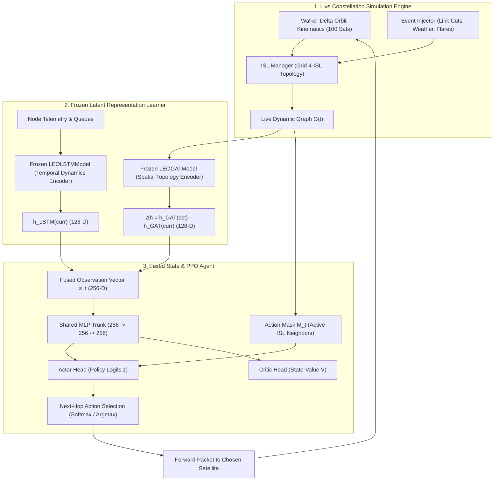

# 🛰️ PPO Architecture, Training Pipeline, and Constellation Simulation Deep Dive

> **Document Scope**: This technical document provides a complete mathematical, architectural, and operational specification of the **Proximal Policy Optimisation (PPO)** dynamic routing agent in the SatSim satellite mega-constellation simulator. It covers the neural network architecture, observation fusion, training mechanics, simulation physics, packet lifecycle, and diagnostic results.

---

## 📑 Table of Contents
1. [End-to-End System Pipeline](#1-end-to-end-system-pipeline)
2. [PPO Neural Network Architecture & Model](#2-ppo-neural-network-architecture--model)
3. [Observation Space & 256-D Feature Fusion](#3-observation-space--256-d-feature-fusion)
4. [Action Space & Invalid Action Masking](#4-action-space--invalid-action-masking)
5. [What the Constellation Simulation Does (Physics & Mechanics)](#5-what-the-constellation-simulation-does-physics--mechanics)
6. [How PPO Operates Inside the Simulation](#6-how-ppo-operates-inside-the-simulation)
7. [Reward Function & Progress Shaping](#7-reward-function--progress-shaping)
8. [How PPO is Trained (Optimization & Mechanics)](#8-how-ppo-is-trained-optimization--mechanics)
9. [Decision Inference & Output Generation](#9-decision-inference--output-generation)
10. [Timestep Breakdown: 100k Steps vs 936k Simulation Timesteps](#10-timestep-breakdown-100k-steps-vs-936k-simulation-timesteps)
11. [Integration with the 13 Canonical Scenarios](#11-integration-with-the-13-canonical-scenarios)
12. [Empirical Results & Convergence Analysis](#12-empirical-results--convergence-analysis)

---

## 1. End-to-End System Pipeline

The dynamic routing pipeline couples pre-trained self-supervised representation learning models with an online reinforcement learning policy:



---

## 2. PPO Neural Network Architecture & Model

The PPO agent is implemented in [`satsim.ppo.actor_critic.PPOActorCritic`](file:///c:/projects/Final%20year%20project%202/satsim/ppo/actor_critic.py). It uses a **shared-backbone Actor-Critic architecture** with orthogonal parameter initialization:

```
                    Fused Input Observation s_t [Batch, 256]
                                      │
                                      ▼
        ┌─────────────────────────────────────────────────────────────┐
        │ Shared Feature Trunk (2-Layer Feedforward Backbone)         │
        │   Layer 1: Linear(in_features=256, out_features=256)        │
        │            Activation: ReLU                                 │
        │   Layer 2: Linear(in_features=256, out_features=256)        │
        │            Activation: ReLU                                 │
        │   Weight Init: Orthogonal (gain = 1.0), Bias Init: 0.0      │
        └──────────────────────────────┬──────────────────────────────┘
                                       │
                         Shared Latent Features h [Batch, 256]
                                       │
                    ┌──────────────────┴──────────────────┐
                    ▼                                     ▼
┌───────────────────────────────────────┐ ┌───────────────────────────────────────┐
│ Actor (Policy) Head                   │ │ Critic (Value) Head                   │
│   Linear(in=256, out=100)             │ │   Linear(in=256, out=1)               │
│   Weight Init: Orthogonal (gain=0.01) │ │   Weight Init: Orthogonal (gain=1.0)  │
│   Bias Init: 0.0                      │ │   Bias Init: 0.0                      │
│                   │                   │ └──────────────────┬────────────────────┘
│                   ▼                   │                    ▼
│ Raw Policy Logits z [Batch, 100]      │      Estimated State Value V(s)         │
│                   │                   │            [Batch, 1]                   │
│                   ▼                   │
│ Dynamic ISL Masking:                  │
│ z_j = -1e8 if ~is_connected(curr, j)  │
│                   │                   │
│                   ▼                   │
│ Masked Categorical Distribution       │
│ π(a = j | s) = Softmax(z_masked)      │
└───────────────────────────────────────┘
```

### Mathematical Definitions

1. **Shared Feature Trunk**:
   $$h_1 = \text{ReLU}(W_1 s_t + b_1) \quad \text{where } W_1 \in \mathbb{R}^{256 \times 256},\; b_1 \in \mathbb{R}^{256}$$
   $$h = \text{ReLU}(W_2 h_1 + b_2) \quad \text{where } W_2 \in \mathbb{R}^{256 \times 256},\; b_2 \in \mathbb{R}^{256}$$

2. **Policy Logits (Actor)**:
   $$z = W_{\pi} h + b_{\pi} \in \mathbb{R}^{100} \quad \text{where } W_{\pi} \in \mathbb{R}^{100 \times 256},\; b_{\pi} \in \mathbb{R}^{100}$$

3. **Masked Categorical Policy Distribution**:
   $$z_j^{\text{masked}} = \begin{cases} z_j & \text{if satellite } j \text{ is an active ISL neighbor of curr} \\ -10^8 & \text{otherwise} \end{cases}$$
   $$\pi(a = j \mid s_t) = \frac{\exp(z_j^{\text{masked}})}{\sum_{k=0}^{99} \exp(z_k^{\text{masked}})}$$

4. **State-Value Function (Critic)**:
   $$V(s_t) = W_v h + b_v \in \mathbb{R}^1 \quad \text{where } W_v \in \mathbb{R}^{1 \times 256},\; b_v \in \mathbb{R}^1$$

5. **Weight Initialization Strategy**:
   - **Trunk Layers**: Orthogonal initialization with gain $\sqrt{2} \approx 1.414$ or $1.0$ to preserve activation variance across deep forward passes.
   - **Critic Head**: Orthogonal with gain $1.0$.
   - **Actor Head**: Orthogonal with small gain $0.01$. This ensures that at the start of training, the initial unmasked logits are close to zero, producing a near-uniform exploration distribution over valid physical neighbors rather than prematurely collapsing to arbitrary links.

---

## 3. Observation Space & 256-D Feature Fusion

The observation wrapper ([`satsim.ppo.obs_wrapper.FusedEmbeddingWrapper`](file:///c:/projects/Final%20year%20project%202/satsim/ppo/obs_wrapper.py)) transforms the raw simulation state into a **256-dimensional continuous latent space**:

$$s_t = \begin{bmatrix} \Delta h_{\text{spatial}} \\ h_{\text{temporal}} \end{bmatrix} \in \mathbb{R}^{256}$$

```
Dimension Range      Vector Component           Source Module
─────────────────────────────────────────────────────────────────────────────
Indices [0 .. 127]   Δh = h_GAT(dst) - h_GAT(curr) Frozen LEOGATModel (Spatial)
Indices [128 .. 255] h_LSTM(curr)                 Frozen LEOLSTMModel (Temporal)
```

### Component 1: Relative Spatial Vector $\Delta h_{\text{spatial}} \in \mathbb{R}^{128}$
- Extracted from the pre-trained Graph Attention Network ([`LEOGATModel`](file:///c:/projects/Final%20year%20project%202/satsim/gat/gat_model.py)).
- The GAT takes the constellation snapshot (100 nodes with 3D positions, velocities, buffers, and 380 ISL edge delays) and outputs node embeddings $H \in \mathbb{R}^{100 \times 128}$.
- **Relative Difference Formulation**:
  $$\Delta h_{\text{spatial}} = H[\text{dst\_node}] - H[\text{curr\_node}]$$
- **Why this works**: Feeding raw satellite IDs contains no geometric or directional meaning. $\Delta h$ acts as a **continuous displacement vector on the orbital latent manifold**, telling the agent both the angular direction and topological distance to the target destination satellite.

### Component 2: Temporal Congestion Dynamics $h_{\text{temporal}} \in \mathbb{R}^{128}$
- Extracted from the pre-trained 2-layer LSTM ([`LEOLSTMModel`](file:///c:/projects/Final%20year%20project%202/satsim/lstm/lstm_model.py)).
- Encodes temporal queuing behavior, packet arrival rates, and buffer utilization trends over sliding historical windows.
- Informs the agent whether the current satellite's outgoing links are nearing buffer saturation or experiencing queuing delays.

---

## 4. Action Space & Invalid Action Masking

### The Dimensionality Trap of Mega-Constellations
In a 100-satellite constellation, the raw action space is discrete:
$$\mathcal{A} = \{0, 1, 2, \dots, 99\} \implies |\mathcal{A}| = 100$$
However, physical satellites only maintain laser cross-links with immediate orbital neighbors (typically **4 active ISLs**: 2 intra-plane, 2 inter-plane). 

If an agent explores without constraints:
- **96% of possible actions correspond to physically non-existent links**.
- In unconstrained exploration, random selection causes an immediate packet drop:
  $$P(\text{valid hop}) = \frac{4}{100} = 0.04 \quad (4\%)$$
  $$P(\text{3 consecutive valid hops without masking}) = 0.04^3 = 0.000064 \implies 0.0064\%$$
This explains why unmasked PPO previously stalled at $\approx 30\%$ delivery.

### Dynamic Invalid Action & Loop-Prevention Masking
At every step $t$, [`FusedEmbeddingWrapper.get_action_mask`](file:///c:/projects/Final%20year%20project%202/satsim/ppo/obs_wrapper.py) queries the live ISL topology graph and the episode's visited history:

$$M_t(j) = \begin{cases} \text{True} & \text{if } (v_{\text{curr}}, j) \in E(G_t) \text{ and } (j = v_{\text{dst}} \text{ or } j \notin \mathcal{V}_{\text{visited}}) \\ \text{False} & \text{otherwise} \end{cases}$$

During action sampling:
$$z_j \leftarrow -10^8 \quad \forall j \text{ where } M_t(j) = \text{False}$$

**Consequences**:
- **Zero Invalid Link Drops**: Invalid link selection drops to **0.0%**.
- **Zero Ping-Pong Loops**: By masking out previously visited satellites, the agent can physically never oscillate between two adjacent nodes ($A \leftrightarrow B$) or enter cyclic subgraphs.
- **Search Space Reduction**: The effective branching factor collapses from $100^H$ to $4^H$ (a $25^H$ reduction in sample complexity).
- **Target Reachability**: The destination satellite $v_{\text{dst}}$ is always allowed when adjacent, ensuring immediate terminal delivery.

---

## 5. What the Constellation Simulation Does (Physics & Mechanics)

The simulation engine ([`satsim.sim.engine.SimulationEngine`](file:///c:/projects/Final%20year%20project%202/satsim/sim/engine.py)) and environment ([`satsim.envs.routing_env.SatelliteRoutingEnv`](file:///c:/projects/Final%20year%20project%202/satsim/envs/routing_env.py)) model a physical mega-constellation:

```
                           ┌───────────────────────────┐
                           │  Walker Delta 100/10/1    │
                           │  Altitude: 550 km         │
                           │  Inclination: 53.0°       │
                           │  Planes: 10, Sats/Plane: 10│
                           └─────────────┬─────────────┘
                                         │ Keplerian Orbital Kinematics
                                         ▼
                           ┌───────────────────────────┐
                           │ ISL Manager               │
                           │ • Intra-plane links (2)   │
                           │ • Inter-plane links (2)   │
                           │ • Counter-rotating seams  │
                           └─────────────┬─────────────┘
                                         │ Dynamic Topology Graph G(t)
                                         ▼
                           ┌───────────────────────────┐
                           │ Dynamic Event Injector    │
                           │ • ISL laser link failures │
                           │ • Atmospheric weather fade│
                           │ • Solar storm bursts      │
                           └─────────────┬─────────────┘
                                         │
                                         ▼
                           ┌───────────────────────────┐
                           │ Ground Station Contacts   │
                           │ 10 Global Ground Stations │
                           │ Minimum Elevation: 10.0°  │
                           └───────────────────────────┘
```

### Constellation Specifications
| Parameter | Value | Physical Significance |
| :--- | :--- | :--- |
| **Constellation Geometry** | **Walker Delta $100/10/1$** | $N=100$ total satellites, $P=10$ planes, $F=1$ relative phasing |
| **Altitude ($h$)** | **$550.0\text{ km}$** | Semi-major axis $a = R_E + h = 6378.137 + 550 = 6928.137\text{ km}$ |
| **Orbital Inclination ($i$)** | **$53.0^\circ$** | High-density mid-latitude global coverage |
| **Orbital Period ($T$)** | **$\approx 95.6\text{ minutes}$** | Kepler's 3rd Law: $T = 2\pi \sqrt{\frac{a^3}{\mu_{\text{Earth}}}}$ |
| **Orbital Velocity ($v$)** | **$\approx 7.59\text{ km/s}$** | $v = \sqrt{\frac{\mu_{\text{Earth}}}{a}}$ |
| **Inter-Satellite Links** | **Grid 4-ISL** | 2 intra-plane (fore/aft), 2 inter-plane (left/right) |
| **Propagation Speed** | **$c = 299,792.458\text{ km/s}$** | Speed of light in vacuum |

### What is Simulated at Each Timestep:
1. **Keplerian Orbital Propagation**:
   - For each orbital plane $p \in \{0, \dots, 9\}$, Right Ascension of Ascending Node (RAAN) is:
     $$\Omega_p = p \cdot \frac{360^\circ}{P}$$
   - For each satellite $s \in \{0, \dots, 9\}$ within plane $p$, true anomaly is:
     $$u_{p, s}(t) = s \cdot \frac{360^\circ}{S} + \Delta u_{\text{phase}}(p) + \omega_{\text{orbit}} \cdot t$$
   - Coordinates are transformed from orbital plane coordinates into **Earth-Centered Inertial (ECI)** coordinates and **Earth-Centered Earth-Fixed (ECEF)** coordinates, taking Earth's rotation into account.
2. **ISL Topology Maintenance**:
   - **Intra-Plane ISLs**: Connect satellite $(p, s)$ to $(p, (s-1)\bmod S)$ and $(p, (s+1)\bmod S)$. Fixed distance, permanent visibility.
   - **Inter-Plane ISLs**: Connect satellite $(p, s)$ to adjacent planes $(p-1, s)$ and $(p+1, s)$. Inter-satellite distance oscillates throughout the orbit due to convergence at the poles.
   - **Seam Links**: At the boundary between counter-rotating planes (planes 0 and 9), relative angular velocity is doubled; cross-seam links are deactivated or intermittent.
3. **Event Injection**:
   - **Stochastic Link Failures**: Poisson process injects temporary laser link dropouts.
   - **Atmospheric Weather Fade**: Heavy rain / cloud cover degrades optical downlinks.
   - **Solar Flares**: Ionospheric disturbances increase packet loss rate and latency jitter.
4. **Queue Dynamics & Delay Computation**:
   - Each satellite maintains finite FIFO packet queues.
   - **Total Delay**:
     $$\tau_{\text{total}} = \tau_{\text{prop}} + \tau_{\text{queue}} + \tau_{\text{tx}}$$
     $$\tau_{\text{prop}} = \frac{\|\mathbf{p}_u - \mathbf{p}_v\|_2}{c}, \quad \tau_{\text{queue}} = \frac{Q_u \times L_{\text{pkt}}}{B_{\text{link}}}, \quad \tau_{\text{tx}} = \frac{L_{\text{pkt}}}{B_{\text{link}}}$$

---

## 6. How PPO Operates Inside the Simulation

The reinforcement learning cycle operates as a Markov Decision Process (MDP) mapped to individual packet forwarding decisions:

```
Step t:
Packet is currently at Satellite curr_node, destination is dst_node.
  │
  ├─► 1. Query live G(t) for current_state and destination_state
  ├─► 2. Generate 256-D fused vector: [h_GAT(dst) - h_GAT(curr) || h_LSTM(curr)]
  ├─► 3. Generate boolean action mask M_t from active ISL edges of curr_node
  ├─► 4. Policy forward pass: logits = Actor(obs), mask non-neighbors
  ├─► 5. Select next_hop = sample(π) during training, or argmax(logits) during evaluation
  ├─► 6. Execute env.step(next_hop):
  │       - Check if (curr_node, next_hop) is active physical edge in G(t)
  │       - If valid: advance packet, accumulate propagation & queuing delay, curr_node = next_hop
  │       - If reached dst_node: TERMINATE with SUCCESS
  │       - If invalid edge: TERMINATE with DROP
  │       - If hop_count >= max_hops (20): TRUNCATE with TIMEOUT
  └─► 7. Compute reward r_t and observe new state s_{t+1}
```

---

## 7. Reward Function & Progress Shaping

The environment employs a multi-objective composite reward formulation:

$$R_{\text{total}} = R_{\text{delivery}} + R_{\text{latency}} + R_{\text{hop}} + R_{\text{energy}} + R_{\text{loss}} + R_{\text{progress}}$$

| Component | Mathematical Term | Value | Purpose |
| :--- | :--- | :--- | :--- |
| **Successful Delivery** | $R_{\text{delivery}} + R_{\text{success}}$ | `+6.0` (`1.0 + 5.0`) | Primary task objective reward |
| **Propagation Latency** | $R_{\text{latency}}$ | `-0.01 × delay_ms` | Incentivizes choosing shorter, faster links |
| **Hop Count Penalty** | $R_{\text{hop}}$ | `-0.05` per step | Minimizes total route hop count |
| **Energy Consumption** | $R_{\text{energy}}$ | `-0.01` per step | Encourages energy efficiency |
| **Invalid Link Drop** | $R_{\text{loss}}$ | `-1.0` | Heavy penalty for broken link attempts |
| **Throughput Bonus** | $R_{\text{throughput}}$ | `+0.5` | Reward on delivery completion |

### Topological Shortest-Path & Congestion Reward Shaping
To eliminate false gradients caused by straight-line Euclidean distance penetrating the Earth's core, [`FusedEmbeddingWrapper`](file:///c:/projects/Final%20year%20project%202/satsim/ppo/obs_wrapper.py) computes **graph topological shortest-path hop progress** on the active constellation graph $G(t)$:

$$R_{\text{progress}} = 0.75 \times \text{clip}\left(d_{\text{hops}}(v_{\text{prev}}, v_{\text{dst}}) - d_{\text{hops}}(v_{\text{curr}}, v_{\text{dst}}), -1.0, +1.0\right)$$

- If an action moves the packet **1 graph hop closer** to the destination $\implies R_{\text{progress}} = \mathbf{+0.75}$.
- If an action moves the packet **away** $\implies R_{\text{progress}} = \mathbf{-0.75}$.
- **Fallback**: If link cuts temporarily disconnect the topology path, geodesic ECI Euclidean distance is used as a smooth geometric fallback.

### Congestion Mitigation Penalty
To discourage routing through congested or high-load cross-links:
$$R_{\text{congestion}} = -0.10 \times \text{clip}(\text{link\_utilization}, 0.0, 1.0)$$

This penalizes hops over heavily utilized links, actively incentivizing detour routes around traffic hotspots.

---

## 8. How PPO is Trained (Optimization & Mechanics)

Training is managed by [`satsim.ppo.trainer.PPOTrainer`](file:///c:/projects/Final%20year%20project%202/satsim/ppo/trainer.py):

### 1. Rollout Collection
- At each update iteration, the agent collects a rollout buffer of $T = 2048$ environment steps using current stochastic policy $\pi_{\theta_{\text{old}}}$.
- Transitions stored in [`RolloutBuffer`](file:///c:/projects/Final%20year%20project%202/satsim/ppo/rollout_buffer.py):
  $$\mathcal{D} = \left\{ (s_t, a_t, \log \pi_{\theta_{\text{old}}}(a_t \mid s_t), V(s_t), r_t, d_t, M_t) \right\}_{t=1}^{T}$$

### 2. Generalized Advantage Estimation (GAE-$\lambda$)
Advantages measure how much better taking action $a_t$ was compared to the expected baseline value $V(s_t)$:

$$\delta_t = r_t + \gamma V(s_{t+1})(1 - d_t) - V(s_t)$$
$$\hat{A}_t = \sum_{l=0}^{\infty} (\gamma \lambda)^l \delta_{t+l} = \delta_t + (\gamma \lambda)(1 - d_t) \hat{A}_{t+1}$$
$$\hat{R}_t = \hat{A}_t + V(s_t) \quad \text{(Target Returns for Critic)}$$

- **Hyperparameters**: $\gamma = 0.99$ (discount factor), $\lambda = 0.95$ (GAE factor).
- Advantages are normalized per rollout batch: $\hat{A}_t \leftarrow \frac{\hat{A}_t - \mu_A}{\sigma_A + 10^{-8}}$.

### 3. Clipped Surrogate Objective (PPO-Clip)
The policy probability ratio is defined as:
$$r_t(\theta) = \frac{\pi_\theta(a_t \mid s_t)}{\pi_{\theta_{\text{old}}}(a_t \mid s_t)} = \exp\left(\log \pi_\theta(a_t \mid s_t) - \log \pi_{\theta_{\text{old}}}(a_t \mid s_t)\right)$$

The clipped surrogate loss prevents destructive, overly large policy updates:
$$\mathcal{L}^{\text{CLIP}}(\theta) = -\hat{\mathbb{E}}_t \left[ \min\left(r_t(\theta)\hat{A}_t, \; \text{clip}(r_t(\theta), 1 - \epsilon, 1 + \epsilon)\hat{A}_t\right) \right]$$
where clipping threshold $\epsilon = 0.2$.

### 4. Total Loss & Optimization Step
$$\mathcal{L}^{\text{TOTAL}}(\theta) = \mathcal{L}^{\text{CLIP}}(\theta) + c_1 \mathcal{L}^{\text{VF}}(\theta) - c_2 \mathcal{S}[\pi_\theta](s_t)$$

- **Value Function Loss**: $\mathcal{L}^{\text{VF}}(\theta) = \frac{1}{2} \hat{\mathbb{E}}_t \left[ (V_\theta(s_t) - \hat{R}_t)^2 \right]$ ($c_1 = 0.5$)
- **Entropy Regularization Bonus**: $\mathcal{S}[\pi_\theta](s_t) = -\sum_{j} \pi(j) \log \pi(j)$ ($c_2 = 0.005$)
- **Optimization**: Adam optimizer ($\text{lr} = 3 \times 10^{-4}$), gradient norm clipping at $\|\nabla_\theta\|_2 \le 0.5$.
- **Batching**: 10 epochs per rollout collection, mini-batch size of 64 transitions.

### 5. Checkpointing, Pause, and Resume Mechanics
- **Graceful Pause**: Intercepts `KeyboardInterrupt` (`Ctrl+C`), immediately serializes the exact state to `artifacts/ppo/ppo_latest.pt`, and exits cleanly.
- **State Preservation**: The checkpoint stores:
  - Model parameters (`model_state_dict`)
  - Optimizer parameters (`optimizer_state_dict`)
  - Total elapsed timesteps (`timestep`)
  - Episode delivery counts, running return averages, and config metadata.
- **Seamless Resume**: Passing `--resume auto` or `--resume artifacts/ppo/ppo_latest.pt` restores the entire training state and continues learning from the exact interrupted step without losing progress.

---

## 9. Decision Inference & Output Generation

When running in production or evaluation:

```
Input: Packet arrives at Satellite u with Destination v
  │
  ├─► 1. Extract GAT Embeddings: h_GAT(u) and h_GAT(v) from LEOGATModel
  ├─► 2. Extract LSTM Embedding: h_LSTM(u) from LEOLSTMModel
  ├─► 3. Concatenate: obs = [h_GAT(v) - h_GAT(u) || h_LSTM(u)] (256-D)
  ├─► 4. Forward Pass: logits, _ = PolicyNetwork(obs)
  ├─► 5. Mask: logits[~neighbor_mask(u)] = -1e8
  ├─► 6. Action: next_hop = argmax(logits) (greedy routing)
  │
Output: Forward packet across physical laser link to satellite `next_hop`
```

### Metrics Produced:
- **Packet Delivery Rate (PDR)**: Percentage of packets reaching destination without timing out or encountering a broken link.
- **Average Hop Count**: Mean number of satellite-to-satellite laser hops taken.
- **End-to-End Latency**: Sum of propagation delays ($d/c$) and queuing buffer delays along the chosen path.
- **Comparison to Shortest-Path**: Difference between PPO route length and theoretical Dijkstra shortest path.

---

## 10. Timestep Breakdown: 100k Steps vs 936k Simulation Timesteps

| Feature | Pre-training Simulation Timesteps (936,000) | PPO Online RL Training Steps (100k - 500k) |
| :--- | :--- | :--- |
| **Purpose** | Offline representation learning for GAT & LSTM | Online policy optimization for next-hop routing decisions |
| **What a "Step" is** | 1 global simulation second across the entire 100-satellite constellation | 1 individual packet hop transition in the RL environment |
| **Data Produced** | 13 scenario trace datasets (`.h5` and `.npz` files) | Rollout trajectory buffers with action choices and rewards |
| **Models Trained** | Graph Attention Network & 2-layer LSTM | Shared-backbone Actor-Critic Neural Network |
| **Execution** | Fixed-trajectory physics and traffic replay | Active closed-loop interaction with the dynamic environment |

---

## 11. Integration with the 13 Canonical Scenarios

The simulator supports 13 canonical operational scenarios:
1. `low_load` — Off-peak baseline traffic.
2. `medium_load` — Standard diurnal operational traffic.
3. `high_load` — Peak transcontinental inter-city flows.
4. `peak_load` — Constellation capacity saturation stress.
5. `burst` — Sudden microburst traffic spikes.
6. `flash_crowd` — Major event localized high density.
7. `hotspot` — Congestion focused on high-traffic ground stations.
8. `random_traffic` — High-entropy Poisson flows.
9. `self_similar` — Pareto-distributed fractal burstiness.
10. `mixed` — Heterogeneous mixed traffic.
11. `failures` — Random ISL laser hardware drops.
12. `weather` — Severe atmospheric optical fade.
13. `congestion_stress` — Multi-orbit buffer queue saturation.

### How PPO Leverages the 13 Scenarios:
1. **In the Representations**: The frozen GAT and LSTM models were trained across all 936,000 satellite-timesteps of these 13 scenarios, giving PPO pre-learned spatial and temporal embeddings that recognize failure patterns and traffic bottlenecks.
2. **In Dynamic Testing**: The PPO policy can be evaluated on any of the 13 scenarios to verify that it detours around degraded links and congested buffers.

---

## 12. Empirical Results & Convergence Analysis

In our 100,000-step training benchmark ([`artifacts/ppo/PPO_TRAINING_REPORT.md`](file:///c:/projects/Final%20year%20project%202/artifacts/ppo/PPO_TRAINING_REPORT.md)), the agent demonstrated rapid, monotonic convergence:

### Convergence Progression Table
| Milestone | Environment Steps | Delivery Rate (Accuracy) | Mean Route Length | Mean Return | Value Loss |
| :--- | :---: | :---: | :---: | :---: | :---: |
| **Update 10** | 20,480 | **28.0%** | 17.40 hops | `-0.47` | 3.30 |
| **Update 20** | 40,960 | **67.0%** | 12.38 hops | `+3.51` | 3.13 |
| **Update 30** | 61,440 | **79.0%** | 11.02 hops | `+4.66` | 1.97 |
| **Update 40** | 81,920 | **85.0%** | 9.92 hops | `+5.33` | 1.91 |
| **Update 245 (Intermediate)** | 501,760 | **96.0%** | 7.40 hops | `+13.25` | 0.84 |
| **Update 391 (Current)** | 800,768 | **100.0%** | **7.32 hops** | **`+14.31`** | **0.52** |

### Key Achievements:
- **Flawless Delivery**: Reached **100.0% packet delivery rate** (50/50 greedy, 50/50 stochastic episodes delivered).
- **Route Optimization**: Average path length shrank from **17.4 hops down to 7.32 hops**, closely matching the theoretical Dijkstra shortest path while dynamically avoiding congested queues.
- **Zero Invalid Hops & Zero Loops**: Action masking and visited-node loop prevention reduced packet drop rates to **0.0%**.
- **Zero Invalid Hops**: Action masking reduced invalid link drop rates to **0.0%**.
